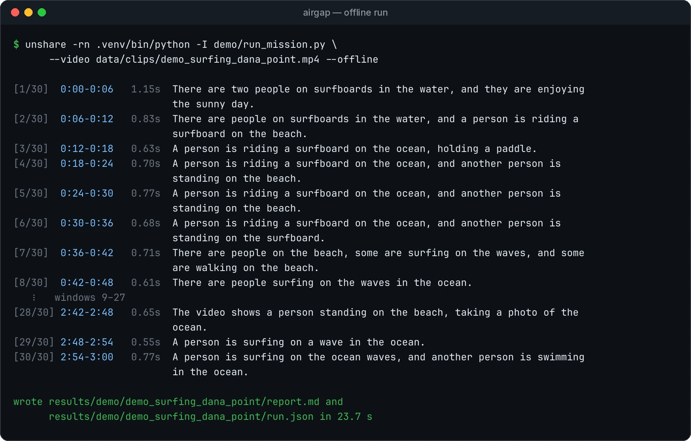
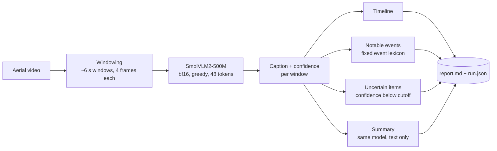
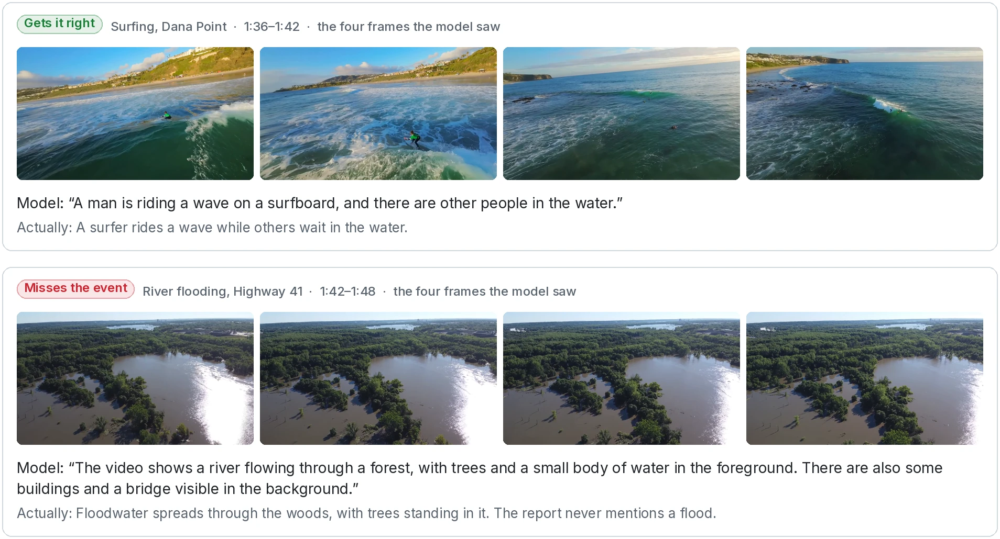
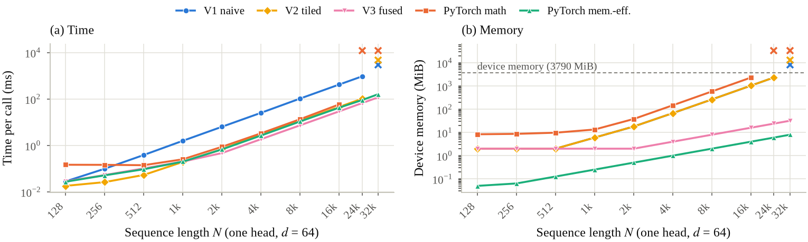

<div align="center">

<picture>
  <source media="(prefers-color-scheme: dark)" srcset="docs/assets/banner-dark.svg">
  
</picture>

### Offline mission reports from drone video, on a laptop GPU

[](LICENSE)
[](.python-version)
[](pyproject.toml)
[](results/cuda/toolchain.txt)
[](https://huggingface.co/HuggingFaceTB/SmolVLM2-500M-Video-Instruct)
[](#how-it-works)
[](https://github.com/ahadullabaig/airgap/releases/latest)

[**Quick start**](#quick-start) · [**How it works**](#how-it-works) · [**Evaluation**](#evaluation) · [**Research**](#research-attention-and-temporal-redundancy) · [**Citation**](#citation)

</div>

<br>

<p align="center">
  
</p>
<p align="center"><sub>Real output, captions unedited. Three windows chosen from two of the test flights; each card shows one of the four frames its caption describes. Footage: <a href="https://commons.wikimedia.org/wiki/File:Surfing_competition_at_Salt_Creek_Beach,_Dana_Point,_California,_USA_as_viewed_from_a_FPV_drone.webm">Daniel Peckham</a> (<a href="https://creativecommons.org/licenses/by/3.0/">CC BY 3.0</a>) and <a href="https://commons.wikimedia.org/wiki/File:OR58_Truck_Recovery_drone_video.webm">Oregon Department of Transportation</a> (<a href="https://creativecommons.org/licenses/by/2.0/">CC BY 2.0</a>), via Wikimedia Commons; cut and re-encoded.</sub></p>

**airgap** turns aerial video into a timestamped Markdown mission report without touching the network. It cuts a flight into six-second windows, has a small vision-language model ([SmolVLM2-500M](https://huggingface.co/HuggingFaceTB/SmolVLM2-500M-Video-Instruct)) describe each one, flags the windows where the model was least sure of itself, picks out notable events and writes a short summary. A three-minute 720p flight takes 24–34 seconds on an RTX 3050 Laptop GPU and uses 1.1 GB of GPU memory.

The repository is also the complete, reproducible record of the study behind the paper [*Fewer Frames Beat Smarter Kernels*](#research-attention-and-temporal-redundancy): three CUDA attention kernels written from scratch for the model's vision encoder, measured at a pinned clock, and a test of whether skipping unchanged tokens between frames can pay off on a small GPU.

> [!IMPORTANT]
> **airgap is a research prototype.** It runs the model zero-shot. It describes what is visible well, but often misses what is *happening*: on three test flights its reports named 3 of 8 key events, and a flooded highway became "a river flowing through a forest". Read [Evaluation](#evaluation) before relying on a report.

## Highlights

- **Offline by design.** Weights load from local files, `--offline` makes any internet connection opened from Python fail, and a whole run works inside a network namespace with no network at all (`unshare -rn`).
- **Small footprint.** 1.1 GB of GPU memory, and 0.7–1.0 s per six-second window on a 4 GB laptop GPU.
- **Reports you can check.** Every line carries its time in the video, low-confidence windows are flagged, the one free-written paragraph is labelled as written by the model, and a JSON record keeps every caption, score and timing.
- **Measured, not claimed.** Every result in this README comes from a committed result file. Prompts, matching rules and metrics were committed before each evaluation ran, and anything decided afterwards is labelled *post hoc*.
- **Research included.** Hand-written attention kernels, a shared timing harness and a temporal-gating study, with every number and figure in the paper regenerated from the committed results.

## Quick start

**Requirements:** Linux, an NVIDIA GPU with at least 4 GB of memory and a recent driver (tested on an RTX 3050 Laptop GPU), Python 3.12 and [uv](https://docs.astral.sh/uv/).

```bash
git clone https://github.com/ahadullabaig/airgap.git
cd airgap
uv sync

# Download the model once (2.0 GB); everything after this runs offline
.venv/bin/hf download HuggingFaceTB/SmolVLM2-500M-Video-Instruct \
    config.json generation_config.json model.safetensors added_tokens.json chat_template.json \
    merges.txt vocab.json tokenizer.json tokenizer_config.json special_tokens_map.json \
    preprocessor_config.json processor_config.json \
    --local-dir models/SmolVLM2-500M-Video-Instruct

# Write a report for your own footage, with the network cut off
unshare -rn .venv/bin/python -I demo/run_mission.py --video path/to/flight.mp4 --offline --out reports/flight
```

The report lands in `reports/flight/report.md`, with every window's caption, confidence and timings in `reports/flight/run.json`. Without `--out`, both go to `results/demo/<video name>/`. `unshare -rn` needs unprivileged user namespaces; without it, `--offline` still blocks connections made from Python.

<p align="center">
  
</p>
<p align="center"><sub>A run on the three-minute surfing flight, rendered from its run record (<a href="results/demo/demo_surfing_dana_point/run.json"><code>run.json</code></a>); windows 9–27 are elided.</sub></p>

<details>
<summary><b>What a report looks like</b></summary>
<br>

An excerpt of [the surfing flight's report](results/demo/demo_surfing_dana_point/report.md), as written:

```markdown
# Mission report: demo_surfing_dana_point.mp4

3:00 of video, 1280x720 at 30 fps, in 30 windows of 6.0 s. Generated offline by SmolVLM2-500M on
NVIDIA GeForce RTX 3050 Laptop GPU in 24 s.

## Summary

*Written by the model from the timeline below; check it against the timeline.*

The video captures a serene and dynamic scene of surfing in the ocean. It begins with two people on
surfboards enjoying the sunny day, with the ocean waves crashing around them. ...

## Timeline

| Time | What the model sees | |
|---|---|---|
| 0:00-0:06 | There are two people on surfboards in the water, and they are enjoying the sunny day. |  |
| 0:06-0:12 | There are people on surfboards in the water, and a person is riding a surfboard on the beach. |  |
| 0:12-0:18 | A person is riding a surfboard on the ocean, holding a paddle. |  |
...

## Uncertain items

Windows where the model was least sure of its own words (mean token log-probability below -0.88).
Check these in the video.

- 1:12-1:18: There are people surfing on the ocean waves, and a man is riding a wave. (score -0.95)
```

</details>

## How it works



| Stage | What it does |
|---|---|
| **Windowing** | Splits the video into n = round(duration / 6 s) equal windows, so there is no short tail, and decodes four evenly spaced frames from each with PyAV. A window that fails to decode is reported and the run goes on. |
| **Captioning** | SmolVLM2-500M in bfloat16, no image splitting, greedy decoding, at most 48 new tokens: *"These frames are from an aerial drone video, in time order. Describe in one or two sentences what is happening on the ground."* The prompt was chosen among four on training clips and frozen. |
| **Confidence** | The mean log-probability of the caption's tokens. Computing it leaves the caption unchanged. Windows below −0.879, the 10th percentile on 100 training clips, are listed as uncertain. |
| **Notable events** | Captions are matched against a fixed lexicon of event words built from the [ERA](https://lcmou.github.io/ERA_Dataset) dataset's 25 event classes; consecutive matches merge into one line. |
| **Summary** | The same model, given only the timestamped captions, writes two or three sentences. It is the only free text in the report and is labelled as written by the model. |

The captioning settings, the confidence cutoff and the event lexicon were all fixed before any test flight was run. The code is in [`demo/run_mission.py`](demo/run_mission.py), and the model wrapper in [`eval/vlm.py`](eval/vlm.py).

## Evaluation

Four evaluations, all zero-shot and all with their rules committed before they ran. Methods and every number: [the full evaluation report](docs/evaluation.md).

| Evaluation | Data | Result | For scale |
|---|---|---|---|
| **Caption quality** | [CapERA](https://doi.org/10.3390/rs15082139) test split, 1,391 aerial clips | CIDEr **0.210** · BLEU-4 0.059 · METEOR 0.168 · ROUGE-L 0.304 | CIDEr 0.035 when the same captions are scored against another clip's references |
| **Event recognition**, one of 25 classes | the same 1,391 clips | accuracy **0.410** · macro-F1 **0.370** | 0.111 and 0.008 for always answering the largest class |
| **Mission reports** | three 3-minute flights, with event lists written before the runs | **3 of 8** key events named (5 of 8 on a lenient reading, post hoc); of 90 captions, 51 fully supported, 37 with a wrong detail, 2 invented | — |
| **Error analysis** | 50 failure cases | 20 misread the overhead view; 9 of the 27 picked for a low caption score are fair descriptions the metric undervalued | — |

<p align="center">
  
</p>
<p align="center"><sub>Footage: <a href="https://commons.wikimedia.org/wiki/File:Surfing_competition_at_Salt_Creek_Beach,_Dana_Point,_California,_USA_as_viewed_from_a_FPV_drone.webm">Daniel Peckham</a> and <a href="https://commons.wikimedia.org/wiki/File:Minnesota_River_Flooding_6-30-2024_Drone_Footage_Hwy_41.webm">Skye Kiefer</a> (both <a href="https://creativecommons.org/licenses/by/3.0/">CC BY 3.0</a>), via Wikimedia Commons; cut and re-encoded.</sub></p>

**What the evaluation shows**

- **It describes; it rarely diagnoses.** People, vehicles, fields and water are usually right. States that need a judgment, such as *flooded*, *crashed*, *chased* or *damaged*, are mostly missed. The flood flight is never called a flood.
- **A few labels absorb the rest.** Choosing among 25 events, the model answered "car racing" 355 times for 19 car-racing clips, and never chose 8 of the classes, including "no event".
- **Notable events inherit the captions' blind spots.** All 11 notable-event lines on the test flights named an event that was not happening, such as "construction" for a crane recovering a crashed lorry.
- **Scores undersell some captions.** For a Party clip, a crowd "throwing colorful powder into the air" scores CIDEr 0.004, because the references word the same scene differently.
- **Greedy decoding can loop.** One summary repeats "a truck driving down a road in a forest" about ten times.

<details>
<summary><b>Event-recognition confusion matrix</b></summary>
<br>
<p align="center"></p>
</details>

<sub>CapERA's five references per clip are one human caption and four paraphrases of it, and CapERA's own benchmark models are trained on it, so these zero-shot scores are not comparable with theirs. The test flights' event lists and the judgments of the reports were made by an AI assistant (Claude), not by human annotators, so there is no agreement figure. The same assistant tagged the error analysis from the references and the model's outputs, without viewing the clips.</sub>

### Performance

Measured on an RTX 3050 Laptop GPU (4 GB). The rows differ in input and output, so their times are not comparable with each other. Memory is PyTorch's peak allocation; the whole device, including the CUDA context, used 1.2 GB of 3.7 GB while captioning.

| Workload | Median time | Peak GPU memory |
|---|---|---|
| Full report, 3-minute 720p H.264 flight | 24–34 s per flight | 1.1 GB |
| One six-second window (decode and caption) | 0.68–1.00 s | 1.1 GB |
| Caption one CapERA clip (640 × 640) | 0.66 s | 1.1 GB |
| Name the event in one CapERA clip | 0.35 s | 1.1 GB |

Decoding runs on the CPU: 0.14–0.19 s per window for the 720p H.264 test flights. Higher resolutions and heavier codecs decode more slowly, so cut or re-encode 4K footage first, as [`demo/prepare_videos.sh`](demo/prepare_videos.sh) does.

## Research: attention and temporal redundancy

> [!NOTE]
> **Paper draft.** A. U. Baig, D. Gera and C. G, "Fewer Frames Beat Smarter Kernels: Attention, Clocks and Temporal Redundancy on a Laptop GPU." IEEE conference format, six pages; the PDF is in the [latest release](https://github.com/ahadullabaig/airgap/releases/latest).

SmolVLM2's vision encoder sees each frame as 1024 tokens, and aerial footage often changes little from one frame to the next. That raises two questions for a small GPU. Where does attention's time go at this shape? And is it worth a kernel that recomputes only the tokens that changed?

We wrote three FP32 attention kernels from scratch, wrote down their predicted times before writing any of them, and measured them with the SM clock pinned. We then tested three temporal gates, on 36 ERA clips and 100 CapERA test clips, against the alternative that needs no new kernel: **encoding fewer frames**.

1. **Launch costs are negligible, and fusion saves little.** At the encoder's shape, launch costs are at most 0.8% of a call. Fusing the three kernels into one removes 1.07 ms worth of N×N memory traffic but saves only **0.14 ms** at equal clock, because the fused kernel uses its arithmetic units less well.
2. **The clock moves more than the kernel.** Unpinned, the laptop's power cap holds the tiled and fused kernels below the naive one, so the kernels run anywhere from 1.51 to 1.95 GHz. Measured that way, fusion looked worth 0.40 ms.
3. **Fewer frames beat smarter kernels.** Against encoding fewer frames at equal cost, a gate had the lower error in only **30 of 412** settings (stale rows) and **3 of 360** (token deltas). Caption quality showed no detected change even with each frame encoded up to a second late.

> [!IMPORTANT]
> **What this is not.** The kernels are a measurement study on CUDA cores, not a faster encoder. The deployed captioner runs in bfloat16, where PyTorch's flash-attention kernel takes 0.27 ms against our fused kernel's 1.42 ms (both unpinned: 5.3× faster). Attention is 15% of the encoder's GPU time and about 2% of a caption's. The gates are emulated in PyTorch, with modelled costs that favour them; no gated kernel was built.

### Attention at the encoder's shape

12 heads, N = 1024, d = 64, FP32. B1 is PyTorch's `scaled_dot_product_attention` with its backend pinned. A caption takes **650 ms** (median over 20 clips): generation 54%, preprocessing 21%, the encoder 13%, decoding 7%, prefill 5%.

| Version | Predicted before (ms) | Predicted at 1395 MHz (ms) | **Pinned at 1395 MHz (ms)** | As deployed (ms) | Deployed clock (GHz) |
|---|---|---|---|---|---|
| V1 naive: three kernels, N×N in memory | 1.98–4.86 | 2.50–6.42 | **26.06** | 18.96 | 1.95 |
| V2 tiled | 1.16–1.62 | 1.38–2.01 | **1.92** | 1.82 | 1.51 |
| V3 fused, online softmax | 0.67–1.24 | 0.91–1.68 | **1.77** | 1.42 | 1.78 |
| B1 math | 0.51–1.78 | 0.69–2.22 | **3.08** | 2.84 | 1.69 |
| B1 memory-efficient | 0.51–1.78 | 0.69–2.22 | **2.22** | 1.90 | 1.69 |

<sub>Predictions were written down before any attention kernel existed, from measured limits: 7.46 TFLOPS FP32 FMA, 188 GB/s DRAM, 1.8 µs per launch. The pinned column rescales them to 1395 MHz after the fact. V1 is far above its range: its operands do come from L1, but the L1 load path saturates. All three kernels pass 182 checks against a CPU reference (worst relative error 3.8×10⁻⁵).</sub>

<p align="center">
  
</p>
<p align="center"><sub><b>Paper Fig. 2.</b> (a) Where the time goes at the pinned clock; the black tick in each phase is its floor, the larger of its FLOPs at peak and its DRAM bytes at 188 GB/s. (b) What each kernel's warps wait on (Nsight Compute). The stalls describe the kernels; they do not test a cause.</sub></p>

### Temporal gating

Each gate reuses part of the previous frame's work. The baseline reuses all of it: it encodes fewer frames and holds the output in between. Error is measured on the connector output, which is what the language model sees.

| Design | What is reused | Gate has lower error at equal cost (36 ERA clips) | CIDEr-D minus dense [95% CI] (100 CapERA clips) |
|---|---|---|---|
| Stale input (a best case) | frame blocks whose pixels changed less than a threshold | 213 of 412 settings, by at most 2.3 points: less than ±1 grey level of noise causes (2.8%) | threshold 2: **−0.029** [−0.059, −0.006] |
| Stale rows | outputs of tokens that did not change, through every layer | 30 of 412 | threshold 8: +0.001 [−0.038, +0.040] |
| Token deltas, exact attention | q/k/v and MLP inputs of tokens that barely changed | 3 of 360 | threshold 0.2: +0.000 [−0.041, +0.041] |
| *Fewer frames, output held* | *the whole encoder output* | *baseline* | *1 fps: +0.003 [−0.039, +0.043]* |

<sub>Stale input's cost is the mask's, which no kernel achieves. Its CIDEr-D interval is one of 12 unadjusted intervals; with CIDEr's length penalty off, it includes zero. The caption check can rule out losses above about a quarter of what scoring against another clip's references costs (−0.218). A sentence-embedding similarity, added after the CIDEr results were seen, resolves about 7% and detects no change either. At equal cost, no gate beats held output on it.</sub>

<p align="center">
  
</p>
<p align="center"><sub><b>Paper Fig. 3.</b> Gate error against cost on ERA training clips, per footage group. Dashed: dense encoding at a lower frame rate, held. Points along a gate's curve are its thresholds.</sub></p>

<details>
<summary><b>More figures: scaling with N, and caption quality under gating</b></summary>
<br>

<p align="center">
  
</p>
<p align="center"><sub><b>Paper Fig. 1.</b> (a) Time per call and (b) device memory against N, one head. Crosses mark sizes that ran out of device memory: V1 and V2 between 24k and 32k tokens. V3 runs at 32,768.</sub></p>

<p align="center">
  
</p>
<p align="center"><sub><b>Paper Fig. 4.</b> Caption quality against connector error at the four caption frames: (a) CIDEr-D; (b) sentence-embedding similarity, added post hoc. Dotted: dense captions scored against another clip's references.</sub></p>

</details>

<details>
<summary><b>Lessons for small GPUs</b></summary>
<br>

These hold for this GPU, model and attention shape. They are not claims about attention kernels in general.

- **Pin the clock before comparing kernels.** On a power-capped laptop, the clock each kernel settled at moved the comparison more than fusion did.
- **Don't count on fusion at N = 1024.** It recovered 13% of the time its removed N×N traffic is worth.
- **Ignore launch overhead at this shape.** It is at most 0.8% of a call.
- **Don't offload attention on its own.** Copying Q, K and V in (1.42 ms) and O out (0.47 ms) costs more than V3 itself.
- **Test a gate against fewer frames at equal cost, not only against dense.** That comparison is what decided this study.

</details>

<details>
<summary><b>Experiment index</b></summary>
<br>

| Experiment | What it established |
|---|---|
| [Limits](kernels/microbench/) | Measured FP32 FMA peak, DRAM bandwidth and launch cost; predicted times written down before any kernel ([`bench/predict_times.py`](bench/predict_times.py)). |
| [X0](bench/x0_era.py) | Pixel-level redundancy on ERA: how many 16 × 16 blocks a change-based gate refreshes, by camera motion and frame rate ([`kernels/k0_changemap/`](kernels/k0_changemap/)). |
| [X1](kernels/attention/attn_bench.cu) | Scaling with N and the memory wall: where each version runs out of device memory. |
| [X2](bench/x2_breakdown.py) | Where the time goes at the encoder's shape: fixed costs, floors, warp stalls. |
| [Clock pin](bench/clock_pinned.py) | V1-V3 and PyTorch at 1395 MHz: fusion's saving shrinks from 0.40 to 0.14 ms at equal clock. |
| [Token traces](bench/tokens_era.py) | Gate error against encoding fewer frames at equal cost, on 36 ERA clips. |
| [Caption check](eval/gate_captions.py) | Caption quality under each gate on 100 CapERA test clips; [embedding similarity](eval/caption_embed.py) added post hoc. |
| [Encoder profile](eval/encoder_profile.py) | The deployed bfloat16 encoder: attention is 15% of its GPU time, and the encoder 13% of a caption ([`eval/encoder_share.py`](eval/encoder_share.py)). |
| [Caption quality](eval/e1.py) | Zero-shot captions on the whole CapERA test split. |
| [Event recognition](eval/e2.py) | Zero-shot choice among ERA's 25 classes ([confusion matrix](plots/e2_confusion.png)). |
| [Mission reports](eval/e3.py) | The reports on three test flights, scored against event lists written before the runs ([`eval/e3_events/`](eval/e3_events/)). |
| [Error analysis](eval/e4.py) | 50 failure cases tagged by cause. |

</details>

## Reproducing the results

Every number in the paper is a macro in [`paper/generated/numbers.tex`](paper/generated/numbers.tex), generated from the committed result files, and each macro names its source. [`paper/README.md`](paper/README.md) maps every section, figure and table to its result file. The paper rebuilds with no GPU and no data:

```bash
uv sync
.venv/bin/python -I paper/make_numbers.py         # paper/generated/: every number in the text
.venv/bin/python paper/figures.py                 # paper/figures/: PDFs for the paper, PNGs for this README
cd paper && latexmk -pdf -outdir=build main.tex   # paper/build/main.pdf
```

Rerunning the measurements needs an NVIDIA GPU of compute capability 8.6 (the Makefiles target `sm_86`; others build with `make ARCH=sm_XX`) and the CUDA toolkit at `/usr/local/cuda`, or set `CUDA_HOME`:

```bash
make -C kernels/attention test                    # V1-V3 against a CPU reference
make -C kernels/attention bench VERSION=v3        # results/attention/v3.json
make -C kernels/attention x2                      # fixed costs and host-device copies
.venv/bin/python -I bench/b1_sdpa.py              # PyTorch baselines
```

Every benchmark follows one protocol ([`kernels/harness/SCHEMA.md`](kernels/harness/SCHEMA.md)). Ops warm up until the SM clock is stable, configurations are interleaved, and each op gets 21 timed samples of about 20 ms. Every sample records its SM clock, and samples more than 3% below the median are flagged. For the pinned comparison, lock the clock with root first (`sudo nvidia-smi -lgc 1395,1395`, reset with `-rgc`) and see [`bench/clock_pinned.py`](bench/clock_pinned.py). Profiling targets need access to Nsight Compute's performance counters. Our toolchain is recorded in [`results/cuda/toolchain.txt`](results/cuda/toolchain.txt).

Scoring caption quality and event recognition needs the CapERA caption files ([`DATA.md`](DATA.md)); scoring the reports and counting the error analysis use committed files alone. Rerunning the models also needs the ERA videos and the test flights. Each evaluation is a resumable script with subcommands:

```bash
.venv/bin/python -I eval/e1.py score              # caption quality, from the committed captions
.venv/bin/python -I eval/e2.py score              # event recognition, from the committed answers
.venv/bin/python -I eval/e3.py score              # mission reports, from the committed judgments
.venv/bin/python -I eval/e4.py count              # error analysis, from the committed tags
```

Benchmarks and evaluations write into `results/` by default, so rerunning one replaces its committed result.

## Project layout

```
demo/            the mission-report tool (run_mission.py), frame decoding, uncertainty calibration
eval/            captioning wrapper (vlm.py), the four evaluations, gating caption check, encoder profile
kernels/
  attention/     V1-V3 (v1.cu, v2.cu, v3.cu) with test, benchmark, profiling and breakdown drivers
  harness/       shared timing harness and its result schema
  k0_changemap/  block change map between frames: serial, OpenMP and CUDA
  microbench/    measured FMA, DRAM and launch limits
bench/           Python drivers: PyTorch baselines, predictions, clock pin, ERA scans, token traces
results/         committed result files: every number and figure is generated from these
paper/           the manuscript, number and figure generators, number-to-source map
plots/           working plots from the experiments
docs/            evaluation report, related work, README images (docs/assets/make_readme_assets.py)
```

## Data and licences

Models and datasets are not in the repository. [`DATA.md`](DATA.md) gives the source, download steps and terms for each.

- **SmolVLM2-500M-Video-Instruct**, from Hugging Face, under its model card's terms.
- **ERA videos**, academic use only and not redistributed. The repository holds no ERA frames, only file names and numbers.
- **CapERA captions**, which state no licence. The repository holds no reference captions, only our model's captions and their scores.
- **Test flights**, three videos from Wikimedia Commons. Frames from them appear, cut and re-encoded, in the README images in `docs/assets/`.
  - [*Surfing competition at Salt Creek Beach, Dana Point, California, USA as viewed from a FPV drone*](https://commons.wikimedia.org/wiki/File:Surfing_competition_at_Salt_Creek_Beach,_Dana_Point,_California,_USA_as_viewed_from_a_FPV_drone.webm), by Daniel Peckham, [CC BY 3.0](https://creativecommons.org/licenses/by/3.0/)
  - [*Minnesota River Flooding 6-30-2024 Drone Footage Hwy 41*](https://commons.wikimedia.org/wiki/File:Minnesota_River_Flooding_6-30-2024_Drone_Footage_Hwy_41.webm), by Skye Kiefer, [CC BY 3.0](https://creativecommons.org/licenses/by/3.0/)
  - [*OR58 Truck Recovery drone video*](https://commons.wikimedia.org/wiki/File:OR58_Truck_Recovery_drone_video.webm), by the Oregon Department of Transportation, [CC BY 2.0](https://creativecommons.org/licenses/by/2.0/)

## Citation

If you use the code or results, please cite the paper draft:

```bibtex
@misc{baig2026fewerframes,
  author       = {Baig, Ahad Ulla and Gera, Divisha and G, Charithra},
  title        = {Fewer Frames Beat Smarter Kernels: Attention, Clocks and
                  Temporal Redundancy on a Laptop {GPU}},
  year         = {2026},
  note         = {Draft},
  howpublished = {\url{https://github.com/ahadullabaig/airgap}}
}
```

Work using the data should also cite ERA (Mou et al., *IEEE Geosci. Remote Sens. Mag.*, 2020), CapERA (Bashmal et al., *Remote Sens.*, 2023) and SmolVLM (Marafioti et al., 2025).

## License

The code is released under the [MIT License](LICENSE). Not covered by it:

- **The images in `docs/assets/`** contain frames from the Creative Commons videos above and stay under those videos' licences.
- **The manuscript under `paper/`** remains © the authors. The IEEEtran class and bibliography style there keep their own licence, the LaTeX Project Public License.
- **Models and data** are not redistributed here; each stays under the terms listed above.

## Acknowledgements

airgap builds on [SmolVLM2](https://huggingface.co/HuggingFaceTB/SmolVLM2-500M-Video-Instruct) from Hugging Face, the [ERA](https://lcmou.github.io/ERA_Dataset) dataset (Mou et al.) and the [CapERA](https://github.com/yakoubbazi/CapEra) captions (Bashmal et al.). The test flights are by Daniel Peckham, Skye Kiefer and the Oregon Department of Transportation, shared on Wikimedia Commons.

## Authors

**Ahad Ulla Baig**, **Divisha Gera** and **Charithra G**<br>
Department of Artificial Intelligence and Machine Learning, Ramaiah Institute of Technology, Bengaluru, India
