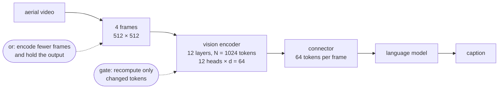
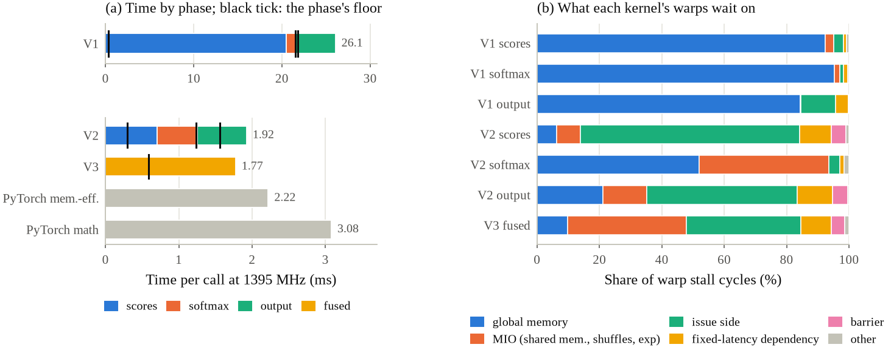
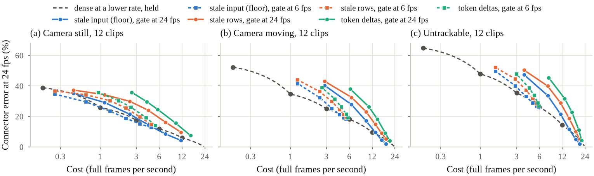

<div align="center">

# airgap

**Is skipping unchanged tokens ever worth more than skipping whole frames, and where does attention's time go on a laptop GPU?**

[](https://github.com/ahadullabaig/airgap/releases/latest)
[](results/cuda/toolchain.txt)
[](results/cuda/peak.json)
[](.python-version)
[](pyproject.toml)
[](LICENSE)

[Paper (PDF)](https://github.com/ahadullabaig/airgap/releases/latest) · [Findings](#key-findings) · [Results](#results) · [Reproduce](#reproducing-the-paper) · [Captioner](#the-captioner) · [Cite](#citation)

</div>

> [!NOTE]
> **Paper draft.** A. U. Baig, D. Gera and C. G, "Fewer Frames Beat Smarter Kernels: Attention, Clocks and Temporal Redundancy on a Laptop GPU." IEEE conference format, six pages; the PDF is in the [latest release](https://github.com/ahadullabaig/airgap/releases/latest). Citations and author details are still being checked before submission.
>
> The repository holds two course projects built on one codebase: this paper (Parallel Programming) and an offline aerial-video captioner with its evaluation (NLP), which is [in progress](#the-captioner).

airgap is an offline captioner for drone video, together with the complete experimental record behind the paper. It runs SmolVLM2-500M with the network off on an RTX 3050 Laptop GPU (4 GB, 16 SMs). Its vision encoder sees each frame as 1024 tokens, and aerial footage often changes little from one frame to the next. That raises two questions for a small GPU. Where does attention's time go at this shape? And is it worth a kernel that recomputes only the tokens that changed?

We wrote three FP32 attention kernels from scratch, wrote down their predicted times before writing any of them, and measured them with the SM clock pinned. We then tested three temporal gates, on 36 ERA clips and 100 CapERA test clips, against the alternative that needs no new kernel: **encoding fewer frames**.

## Key findings

1. **Launch costs are negligible, and fusion saves little.** At the encoder's shape, launch costs are at most 0.8% of a call. Fusing the three kernels into one removes 1.07 ms worth of N×N memory traffic but saves only **0.14 ms** at equal clock, because the fused kernel uses its arithmetic units less well.
2. **The clock moves more than the kernel.** Unpinned, the laptop's power cap holds the tiled and fused kernels below the naive one, so the kernels run anywhere from 1.51 to 1.95 GHz. Measured that way, fusion looked worth 0.40 ms.
3. **Fewer frames beat smarter kernels.** Against encoding fewer frames at equal cost, a gate had the lower error in only **30 of 412** settings (stale rows) and **3 of 360** (token deltas). Caption quality showed no detected change even with each frame encoded up to a second late.

> [!IMPORTANT]
> **What this is not.** The kernels are a measurement study on CUDA cores, not a faster encoder. The deployed captioner runs in bfloat16, where PyTorch's flash-attention kernel takes 0.27 ms against our fused kernel's 1.42 ms (both unpinned: 5.3× faster). Attention is 15% of the encoder's GPU time and about 2% of a caption's. The gates are emulated in PyTorch, with modelled costs that favour them; no gated kernel was built.

## The pipeline



Each caption gets four frames, resized to 512 × 512. The vision encoder cuts each frame into 1024 patches of 16 × 16 pixels and runs 12 transformer layers over them. Attention there has 12 heads of dimension 64: the shape every kernel below is measured at. A connector reduces each frame to 64 tokens for the language model, which writes the caption. A caption takes **650 ms** (median over 20 clips): generation 54%, preprocessing 21%, the encoder 13%, decoding 7%, prefill 5%.

## Results

### Attention at the encoder's shape

12 heads, N = 1024, d = 64, FP32. B1 is PyTorch's `scaled_dot_product_attention` with its backend pinned.

| Version | Predicted before (ms) | Predicted at 1395 MHz (ms) | **Pinned at 1395 MHz (ms)** | As deployed (ms) | Deployed clock (GHz) |
|---|---|---|---|---|---|
| V1 naive: three kernels, N×N in memory | 1.98–4.86 | 2.50–6.42 | **26.06** | 18.96 | 1.95 |
| V2 tiled | 1.16–1.62 | 1.38–2.01 | **1.92** | 1.82 | 1.51 |
| V3 fused, online softmax | 0.67–1.24 | 0.91–1.68 | **1.77** | 1.42 | 1.78 |
| B1 math | 0.51–1.78 | 0.69–2.22 | **3.08** | 2.84 | 1.69 |
| B1 memory-efficient | 0.51–1.78 | 0.69–2.22 | **2.22** | 1.90 | 1.69 |

<sub>Predictions were written down before any attention kernel existed, from measured limits: 7.46 TFLOPS FP32 FMA, 188 GB/s DRAM, 1.8 µs per launch. The pinned column rescales them to 1395 MHz after the fact. V1 is far above its range: its operands do come from L1, but the L1 load path saturates. All three kernels pass 182 checks against a CPU reference (worst relative error 3.8×10⁻⁵).</sub>

<p align="center">
  
</p>
<p align="center"><sub><b>Paper Fig. 1.</b> (a) Time per call and (b) device memory against N, one head. Crosses mark sizes that ran out of device memory: V1 and V2 between 24k and 32k tokens. V3 runs at 32,768.</sub></p>

<p align="center">
  
</p>
<p align="center"><sub><b>Paper Fig. 2.</b> (a) Where the time goes at the pinned clock; the black tick in each phase is its floor, the larger of its FLOPs at peak and its DRAM bytes at 188 GB/s. (b) What each kernel's warps wait on (Nsight Compute). The stalls describe the kernels; they do not test a cause.</sub></p>

### Temporal gating

Each gate reuses part of the previous frame's work. The baseline reuses all of it: it encodes fewer frames and holds the output in between. Error is measured on the connector output, which is what the language model sees.

| Design | What is reused | Gate has lower error at equal cost (36 ERA clips) | CIDEr-D minus dense [95% CI] (100 CapERA clips) |
|---|---|---|---|
| Stale input (a best case) | frame blocks whose pixels changed less than a threshold | 213 of 412 settings, by at most 2.3 points: less than ±1 grey level of noise causes (2.8%) | threshold 2: **−0.029** [−0.059, −0.006] |
| Stale rows | outputs of tokens that did not change, through every layer | 30 of 412 | threshold 8: +0.001 [−0.038, +0.040] |
| Token deltas, exact attention | q/k/v and MLP inputs of tokens that barely changed | 3 of 360 | threshold 0.2: +0.000 [−0.041, +0.041] |
| *Fewer frames, output held* | *the whole encoder output* | *baseline* | *1 fps: +0.003 [−0.039, +0.043]* |

<sub>Stale input's cost is the mask's, which no kernel achieves. Its CIDEr-D interval is one of 12 unadjusted intervals; with CIDEr's length penalty off, it includes zero. The caption check can rule out losses above about a quarter of what scoring against another clip's references costs (−0.218). A sentence-embedding similarity, added after the CIDEr results were seen, resolves about 7% and detects no change either. At equal cost, no gate beats held output on it.</sub>

<p align="center">
  
</p>
<p align="center"><sub><b>Paper Fig. 3.</b> Gate error against cost on ERA training clips, per footage group. Dashed: dense encoding at a lower frame rate, held. Points along a gate's curve are its thresholds.</sub></p>

<p align="center">
  
</p>
<p align="center"><sub><b>Paper Fig. 4.</b> Caption quality against connector error at the four caption frames: (a) CIDEr-D; (b) sentence-embedding similarity, added post hoc. Dotted: dense captions scored against another clip's references.</sub></p>

### Lessons for small GPUs

These hold for this GPU, model and attention shape. They are not claims about attention kernels in general.

- **Pin the clock before comparing kernels.** On a power-capped laptop, the clock each kernel settled at moved the comparison more than fusion did.
- **Don't count on fusion at N = 1024.** It recovered 13% of the time its removed N×N traffic is worth.
- **Ignore launch overhead at this shape.** It is at most 0.8% of a call.
- **Don't offload attention on its own.** Copying Q, K and V in (1.42 ms) and O out (0.47 ms) costs more than V3 itself.
- **Test a gate against fewer frames at equal cost, not only against dense.** That comparison is what decided this project.

## The captioner

The NLP part of the project is an offline command-line tool, in progress. Pointed at an aerial video with the network off, it will write timestamped scene descriptions and a short mission report. Its plan and checklist are in [`PLAN.md`](PLAN.md), sections 2 and 2.6.

| | State |
|---|---|
| Model captions a clip with the network off | Done ([`demo/caption_clip.py`](demo/caption_clip.py)) |
| **E1:** caption quality, zero-shot, all 1,391 CapERA test clips | Done: CIDEr 0.210, BLEU-4 0.059, METEOR 0.168, ROUGE-L 0.304; median 0.66 s per clip ([`results/e1/scores_test.json`](results/e1/scores_test.json)) |
| `run_mission.py`: windows, report, uncertain items | Next |
| **E2:** event recognition over 25 classes, zero-shot, all 1,391 test clips | Done: accuracy 0.410, macro-F1 0.370 (always answering the largest class: 0.111 and 0.008); 0.35 s per clip ([`results/e2/scores_test.json`](results/e2/scores_test.json)) |
| **E3, E4:** scoring the reports; error analysis | After the demo is frozen |

<sub>E1's prompt was chosen on 100 training clips and E2's on 200, each before its own test run. CapERA's five references per clip are one human caption and four paraphrases of it, and CapERA's own benchmark models are trained on it, so these zero-shot numbers are not comparable with theirs.</sub>

## Reproducing the paper

Every number in the paper is a macro in [`paper/generated/numbers.tex`](paper/generated/numbers.tex), generated from the committed result files, and each macro names its source. [`paper/README.md`](paper/README.md) maps every section, figure and table to its result file.

```bash
uv sync                                           # Python environment in .venv

.venv/bin/python -I paper/make_numbers.py         # paper/generated/: every number in the text
.venv/bin/python paper/figures.py                 # paper/figures/: PDFs for the paper, PNGs for this README
cd paper && latexmk -pdf -outdir=build main.tex   # paper/build/main.pdf
```

To rerun the measurements, you need an NVIDIA GPU of compute capability 8.6 (the Makefiles target `sm_86`) and the CUDA toolkit at `/usr/local/cuda`, or set `CUDA_HOME`:

```bash
make -C kernels/attention test                    # V1-V3 against a CPU reference
make -C kernels/attention bench VERSION=v3        # results/attention/v3.json
make -C kernels/attention x2                      # fixed costs and host-device copies
.venv/bin/python -I bench/b1_sdpa.py              # PyTorch baselines
```

Every benchmark follows one protocol ([`kernels/harness/SCHEMA.md`](kernels/harness/SCHEMA.md)). Ops warm up until the SM clock is stable, configurations are interleaved, and each op gets 21 timed samples of about 20 ms. Every sample records its SM clock, and samples more than 3% below the median are flagged. For the pinned comparison, lock the clock with root first (`sudo nvidia-smi -lgc 1395,1395`, reset with `-rgc`) and see [`bench/clock_pinned.py`](bench/clock_pinned.py). Profiling targets need access to Nsight Compute's performance counters. Our toolchain is recorded in [`results/cuda/toolchain.txt`](results/cuda/toolchain.txt).

The caption check's metrics were fixed in a commit before it ran. Every check designed after seeing data is labelled *post hoc*.

## Experiment log

| Experiment | What it established |
|---|---|
| [Limits](kernels/microbench/) | Measured FP32 FMA peak, DRAM bandwidth and launch cost; predicted times written down before any kernel ([`bench/predict_times.py`](bench/predict_times.py)). |
| [X0](bench/x0_era.py) | Pixel-level redundancy on ERA: how many 16 × 16 blocks a change-based gate refreshes, by camera motion and frame rate ([`kernels/k0_changemap/`](kernels/k0_changemap/)). |
| [X1](kernels/attention/attn_bench.cu) | Scaling with N and the memory wall: where each version runs out of device memory. |
| [X2](bench/x2_breakdown.py) | Where the time goes at the encoder's shape: fixed costs, floors, warp stalls. |
| [Clock pin](bench/clock_pinned.py) | V1-V3 and PyTorch at 1395 MHz: fusion's saving shrinks from 0.40 to 0.14 ms at equal clock. |
| [Token traces](bench/tokens_era.py) | Gate error against encoding fewer frames at equal cost, on 36 ERA clips. |
| [Caption check](eval/gate_captions.py) | Caption quality under each gate on 100 CapERA test clips; [embedding similarity](eval/caption_embed.py) added post hoc. |
| [Encoder profile](eval/encoder_profile.py) | The deployed bfloat16 encoder: attention is 15% of its GPU time, and the encoder 13% of a caption ([`eval/encoder_share.py`](eval/encoder_share.py)). |
| [E1](eval/e1.py) | Zero-shot caption quality on the whole CapERA test split. |
| [E2](eval/e2.py) | Zero-shot event recognition over ERA's 25 classes: the model over-uses "car racing" and never answers "no event". |

Supporting documents: the [project plan](PLAN.md), with every decision and its date; [data sources and terms](DATA.md); and the annotated [related work](docs/related_work.md).

<details>
<summary><b>How the project got here</b></summary>
<br>

The plan had a floor and a ceiling. The floor was the kernel ladder, the time breakdown and the memory wall. The ceiling was a gated attention kernel that computes outputs only for the tokens that changed, worth building only if real aerial footage changed little enough between frames.

Two measurements decided it. On ERA clips, encoding fewer frames and holding the output beat the stale-rows and token-delta gates at equal cost, even with the gates' costs modelled in their favour. And on CapERA, captions did not get detectably worse with frames held for up to a second, so there was no quality for a gate to win back. The paper became the floor plus a measured section on why gating does not pay, and the gated kernel is future work.

The clock changed the story too. Measured unpinned, the fused kernel saved 0.40 ms over the tiled one. With the clock pinned, it saved 0.14 ms: most of the difference was the power cap running the two kernels at different clocks.

</details>

## Repository layout

```
kernels/
  attention/     V1-V3 (v1.cu, v2.cu, v3.cu) with test, benchmark, profiling and X2 drivers
  harness/       shared timing harness and its result schema
  k0_changemap/  block change map between frames: serial, OpenMP and CUDA
  microbench/    measured FMA, DRAM and launch limits
  smoke/         toolchain check
bench/           Python drivers: PyTorch baselines, predictions, clock pin, X2 breakdown, ERA scans, token traces
eval/            captioner evaluation (E1, E2), caption-level gating check, encoder profile
demo/            offline captioning of one clip; frame decoding
results/         committed result files: every number and figure is generated from these
plots/           working plots from the experiments; the paper's figures supersede them
paper/           the manuscript, number and figure generators, number-to-source map
docs/            related work
```

## Citation

If you use the code or results, please cite the paper draft:

```bibtex
@misc{baig2026fewerframes,
  author       = {Baig, Ahad Ulla and Gera, Divisha and G, Charithra},
  title        = {Fewer Frames Beat Smarter Kernels: Attention, Clocks and
                  Temporal Redundancy on a Laptop {GPU}},
  year         = {2026},
  note         = {Draft},
  howpublished = {\url{https://github.com/ahadullabaig/airgap}}
}
```

Work using the data should also cite ERA (Mou et al., *IEEE Geosci. Remote Sens. Mag.*, 2020), CapERA (Bashmal et al., *Remote Sens.*, 2023) and SmolVLM (Marafioti et al., 2025).

## Data and terms

Models and data are not in the repository. [`DATA.md`](DATA.md) gives the source, download steps and terms for each:

- **SmolVLM2-500M-Video-Instruct**, from Hugging Face, under its model card's terms.
- **ERA videos**, academic use only and not redistributed. The repository holds no ERA frames, only file names and numbers.
- **CapERA captions**, which state no licence. The repository holds no reference captions, only our model's captions and their scores.

## License

The code is released under the [MIT License](LICENSE). The manuscript under `paper/` is not covered by it and remains © the authors. The IEEEtran class and bibliography style in `paper/` keep their own licence, the LaTeX Project Public License. Models and data are not redistributed here; each stays under the terms listed above.

## Authors

**Ahad Ulla Baig**, **Divisha Gera** and **Charithra G**<br>
Department of Artificial Intelligence and Machine Learning, Ramaiah Institute of Technology, Bengaluru, India
