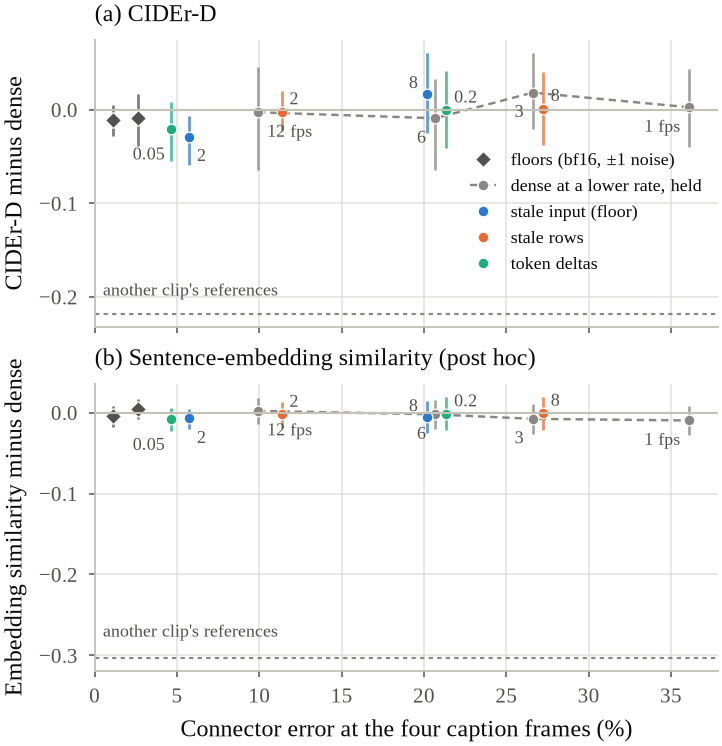

# airgap

Offline captioning of drone video on a 4 GB laptop GPU, and a measurement study of the attention kernels underneath it.

The project has two parts, built on one codebase for two university courses:

- **Part B, Parallel Programming: a paper.** *Fewer Frames Beat Smarter Kernels: Attention, Clocks and Temporal Redundancy on a Laptop GPU.* It is a full draft in IEEE conference format, six pages: source in [`paper/`](paper/), PDF in the [latest release](https://github.com/ahadullabaig/airgap/releases/latest).
- **Part A, NLP: an offline aerial-video captioner** built on SmolVLM2-500M, with an evaluation of its captions. It is in progress: see [Status](#status).

Everything runs on one RTX 3050 Laptop GPU (4 GB, 16 SMs, compute capability 8.6) with the network off.

## The question

The captioner's vision encoder sees each frame as N = 1024 tokens, with 12 attention heads of dimension 64. Aerial footage often changes little from frame to frame, which suggests recomputing only the tokens that changed. The paper asks:

> Is skipping unchanged tokens ever worth more than skipping whole frames, and where does attention's time go on a laptop GPU?

## Findings

All numbers below come from [`paper/generated/numbers.tex`](paper/generated/numbers.tex). Every macro in that file names the result file it was computed from.

**Attention kernels.** We wrote three FP32 kernels from scratch at the encoder's shape: V1 naive (three kernels, with the N×N score matrix in device memory), V2 tiled, and V3 fused with an online softmax. All three are checked against a CPU reference on 10 test cases (182 checks, worst relative error 3.8×10⁻⁵). We wrote down predicted times before writing any kernel.

- At an SM clock pinned to 1395 MHz, a call takes 26.06 ms (V1), 1.92 ms (V2) and 1.77 ms (V3). PyTorch's FP32 attention takes 3.08 ms (math backend) and 2.22 ms (memory-efficient backend).
- Launch costs are at most 0.8% of a call.
- Fusion removes 1.07 ms worth of N×N memory traffic but saves only 0.14 ms (13% of that), because the fused kernel uses its arithmetic units less well.
- Unpinned, the kernels run at different clocks, from 1.51 to 1.95 GHz: the laptop's power cap holds the tiled and fused kernels below the naive one. That made fusion look larger, 0.40 ms unpinned.
- The memory wall follows from N×N storage: V1 and V2 run out of memory between 24k and 32k tokens at one head, while V3 runs at 32,768.


**Temporal gating.** We compared three gate designs against the alternative that needs no new kernel: run the dense encoder at a lower frame rate and hold its output. The three designs are stale input, stale rows, and token deltas with exact attention.

- The gates are emulated in PyTorch. Their cost is modelled, not timed, and the model favours the gates.
- On 36 ERA clips at equal cost, stale rows had the lower error in 30 of 412 settings, and token deltas in 3 of 360.
- Stale input had the lower error in 213 of 412 settings, but at a cost no kernel reaches. Its largest margin, 2.3 points, is below the 2.8% error that ±1 grey level of noise causes.
- On 100 CapERA test clips, encoding fewer frames and holding the output showed no detected change in caption quality, even with each frame up to a second late. We measured CIDEr-D, plus a sentence-embedding similarity added after the CIDEr results were seen.
- Of the 6 gated conditions, only stale input at threshold 2 moved CIDEr-D detectably: −0.029 [−0.059, −0.006], one of 12 unadjusted intervals.
- At equal cost, no gate beat the held output.




**Scope.** The kernels are a measurement study on CUDA cores, not a faster encoder. The deployed captioner runs in bfloat16, where PyTorch's flash-attention kernel takes 0.27 ms against V3's 1.42 ms, both unpinned (5.3× faster). Attention is 15% of the encoder's GPU time and about 2% of a caption's.

## Status

| Part | State |
|---|---|
| B: paper | Full draft, six pages, every number generated from a committed result file. Citations and author details are still to be checked before submission. |
| A: captioner | The model captions a clip offline. E1 (caption quality, zero-shot, all 1,391 CapERA test clips) is done: CIDEr 0.210, BLEU-4 0.059, METEOR 0.168, median 0.66 s per clip ([`results/e1/scores_test.json`](results/e1/scores_test.json)). The `run_mission.py` command line, the report, the demo videos and evaluations E2-E4 are next ([`PLAN.md`](PLAN.md), section 2.6). |

## Repository layout

| Path | Contents |
|---|---|
| [`kernels/attention/`](kernels/attention/) | V1-V3 (`v1.cu`, `v2.cu`, `v3.cu`), with test, benchmark, profiling and X2 drivers |
| [`kernels/harness/`](kernels/harness/) | Shared timing harness: warm-up, interleaving, and per-sample SM clock and throttle logging |
| [`kernels/k0_changemap/`](kernels/k0_changemap/) | Block change map between frames: serial, OpenMP and CUDA |
| [`kernels/microbench/`](kernels/microbench/), [`kernels/smoke/`](kernels/smoke/) | Measured FMA, DRAM and launch limits; toolchain check |
| [`bench/`](bench/) | Python drivers: PyTorch baselines, predictions, clock pin, X2 breakdown, ERA scans, token traces |
| [`eval/`](eval/) | Captioner evaluation (E1) and the caption-level gating check |
| [`demo/`](demo/) | Offline captioning of one clip; frame decoding |
| [`results/`](results/) | Committed result files: every number and figure is generated from these |
| [`plots/`](plots/) | Working plots from the experiments; the paper's figures supersede them |
| [`paper/`](paper/) | The paper: LaTeX, number and figure generators ([`paper/README.md`](paper/README.md)) |
| [`docs/related_work.md`](docs/related_work.md) | Annotated literature search |
| [`PLAN.md`](PLAN.md), [`DATA.md`](DATA.md) | Project plan and decisions; data sources and their terms |

## Reproducing

**Requirements.** An NVIDIA GPU with compute capability 8.6, since the Makefiles target `sm_86`. You also need:
- the CUDA toolkit at `/usr/local/cuda`, which you can override with `CUDA_HOME`;
- [uv](https://docs.astral.sh/uv/) and Python 3.12.

We used CUDA 13.5, PyTorch 2.15 and driver 620.70 on Fedora 44 ([`results/cuda/toolchain.txt`](results/cuda/toolchain.txt)).

```bash
uv sync                                          # Python environment in .venv

make -C kernels/attention test                   # V1-V3 against a CPU reference
make -C kernels/attention bench VERSION=v3       # writes results/attention/v3.json
make -C kernels/attention x2                     # fixed costs and copies at the encoder's shape
.venv/bin/python -I bench/b1_sdpa.py             # PyTorch baselines
```

- **Benchmarks:** plug the laptop in, use the performance profile, and keep other work off the GPU.
- **Profiling targets** (`profile`, `x2-profile`): they need access to Nsight Compute's performance counters.
- **Pinned-clock comparison:** lock the clock with root first (`sudo nvidia-smi -lgc 1395,1395`), and reset it afterwards (`sudo nvidia-smi -rgc`). See [`bench/clock_pinned.py`](bench/clock_pinned.py).

**The paper:**

```bash
.venv/bin/python -I paper/make_numbers.py        # paper/generated/: every number in the text
.venv/bin/python paper/figures.py                # paper/figures/
cd paper && latexmk -pdf -outdir=build main.tex  # paper/build/main.pdf
```

**Models and data** are not in the repository. [`DATA.md`](DATA.md) lists where each one comes from, how to download it, and its terms:
- SmolVLM2-500M;
- the ERA videos (academic use only, not redistributed: the repository holds no ERA frames);
- the CapERA captions (no stated licence: the repository holds no reference captions, only our model's outputs and scores).

## Authors

Ahad Ulla Baig, Divisha Gera and Charithra G, Ramaiah Institute of Technology, Bengaluru.
