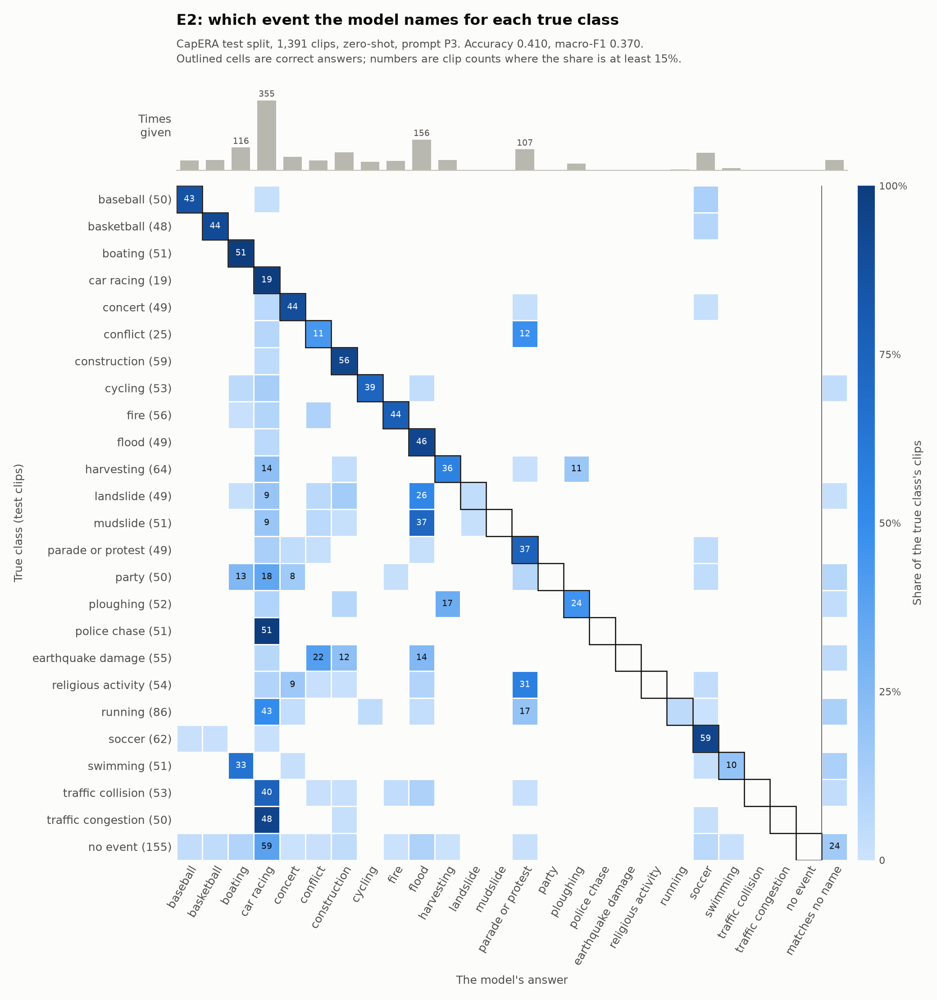

# Part A evaluation: an offline aerial-video captioner

This is the evaluation of Part A, the NLP project: an offline tool that captions aerial video with SmolVLM2-500M and writes a timestamped mission report. It covers the four evaluations in [`PLAN.md`](../PLAN.md) section 2.5. **E1** measures caption quality, **E2** event recognition, **E3** the demo's reports against event lists, and **E4** is an error analysis. Every number below comes from a committed result file, named beside it. Everything was run on one RTX 3050 Laptop GPU (4 GB) with the network off.

All results are **zero-shot**, as far as the model card shows: nothing was trained or fine-tuned on CapERA or ERA, and neither dataset is among the model's named training sets. CapERA's own benchmark models are trained on CapERA, so the numbers here do not belong in a table beside theirs.

## Summary

- **The demo works offline but misses events.** With no network it turns a 3-minute video into a report in 24-34 s, using 1.1 GB of GPU memory. But the reports name only **3 of the 8 main events** in the three demo videos, so the acceptance test's "names the main events" part fails on all three videos under the committed rule. The surfing report names 2 of its 3 and would pass only on a lenient reading added afterwards. The flood video's flooding is never mentioned.
- **E1, caption quality.** CIDEr is 0.210 on all 1,391 CapERA test clips, against 0.035 when the same captions are scored against another clip's references. The captions are on topic, but nearly twice as long as the references (16.7 words against 9.4).
- **E2, event recognition.** Choosing one of 25 class names, the model gets accuracy 0.410 and macro-F1 0.370, against 0.111 and 0.008 for always answering the largest class. It answers "car racing" for most scenes with vehicles, and never answers 8 of the 25 classes.
- **E4, error analysis.** In 50 failure cases, the commonest causes are a misread surface or place: a flooded road seen as sand dunes, a track as a parking lot. 16 of the 50 captions are fair descriptions anyway; for the 9 of them chosen for their low E1 score, the low score is a metric or reference problem, not a captioning one.

## 1. What was evaluated

| | |
|---|---|
| Model | SmolVLM2-500M-Video-Instruct, bf16, loaded from local files |
| Captioning settings | 4 frames per clip or window, no image splitting, greedy decoding, at most 48 new tokens; prompt P1, "These frames are from an aerial drone video, in time order. Describe in one or two sentences what is happening on the ground." Frozen in [`eval/e1_config.json`](../eval/e1_config.json) before the test run |
| Demo | [`demo/run_mission.py`](../demo/run_mission.py): equal windows of about 6 s; one caption per window; a fixed Markdown report with a timeline, notable events (captions containing a word from a fixed list built from ERA's 25 classes), uncertain items (mean token log-probability below -0.879, the 10th percentile on 100 training clips) and a summary paragraph written by the same model from the captions. Frozen as tag `demo-frozen` |
| Offline | Runs under `unshare -rn` (no network namespace) with `HF_HUB_OFFLINE=1`; `--offline` also blocks Python-level internet connections |

## 2. Data

**CapERA test split** (E1, E2, E4): 1,391 clips of about 5.75 s from the ERA dataset, in 25 classes (24 events plus NonEvent), with 5 English captions each. One caption per clip is a human annotation and the other four are generated paraphrases of it, so the five are not independent references. The ERA videos are for academic use only, and CapERA states no licence. This document therefore shows no ERA frames and no CapERA reference text: only class names (from ERA's file names), our model's outputs and the scores.

**Demo videos** (E3): three videos from Wikimedia Commons, each cut to a 3-minute segment and re-encoded at 720p ([`demo/prepare_videos.sh`](../demo/prepare_videos.sh), [`DATA.md`](../DATA.md)):

| Video | Segment used | Credit and licence |
|---|---|---|
| OR58 truck recovery: a crane recovers a crashed lorry from a mountain embankment | 0:00-3:00 | Oregon Department of Transportation, CC BY 2.0; cut and re-encoded |
| Minnesota River flooding over Highway 41 | 0:40-3:40 | Skye Kiefer, CC BY 3.0; cut and re-encoded |
| Surfing competition at Salt Creek Beach, Dana Point, filmed from a first-person drone | 2:00-5:00 | Daniel Peckham, CC BY 3.0; cut and re-encoded |

## 3. E1: caption quality

Every test clip was captioned once with the frozen settings and scored with the standard COCO caption metrics (pycocoevalcap; CIDEr is CIDEr-D). Three controls give the scale: our captions scored against a random other clip's references, one fixed caption for every clip ("an aerial view of buildings, roads and trees"), and the human reference scored against the other four, which is inflated because those four are paraphrases of it. Source: [`results/e1/scores_test.json`](../results/e1/scores_test.json).

| | BLEU-4 | METEOR | ROUGE-L | CIDEr |
|---|---|---|---|---|
| **SmolVLM2-500M, prompt P1** | **0.059** | **0.168** | **0.304** | **0.210** |
| Same captions, another clip's references | 0.013 | 0.090 | 0.206 | 0.035 |
| One fixed caption for every clip | 0.000 | 0.050 | 0.125 | 0.035 |
| Human reference against its paraphrases | 0.733 | 0.488 | 0.801 | 3.172 |

- **The prompt was chosen on training clips.** Four candidate prompts were written before any caption was generated and compared on 100 training clips (4 per class) by CIDEr: P1 0.312, P2 0.194, P3 0.107, P4 0.121. P1's 0.312 is a selection figure on training data, not a test result.
- **Length costs CIDEr.** Captions average 16.7 words, the references 9.4, and 84 captions have more than one sentence. CIDEr-D penalises the length gap: per-clip CIDEr falls as the gap grows (correlation -0.455), and without the length penalty the corpus CIDEr would be 0.381 ([`results/e1/diagnostics_test.json`](../results/e1/diagnostics_test.json); a diagnostic only).
- **Quality varies by class.** The best mean CIDEr is basketball 0.733, cycling 0.519, fire 0.387 and swimming 0.378. The worst is ploughing 0.057, religious activity 0.065, post-earthquake 0.084 and landslide 0.089. Scenes with a distinctive layout do well; scenes defined by a state (damage, a slide) or an activity that looks ordinary from above do badly.

## 4. E2: event recognition

The model was shown each test clip with the 25 class names, one per line, and asked to answer with one. The matching rule was fixed before the run ([`eval/e2.py`](../eval/e2.py)): an answer counts as the class it names when exactly one class name (or a listed variant) appears in it; anything else counts as wrong. Source: [`results/e2/scores_test.json`](../results/e2/scores_test.json); 95% intervals from 10,000 bootstrap resamples of clips.

| | Accuracy | Macro-F1 |
|---|---|---|
| **SmolVLM2-500M, prompt P3** | **0.410** [0.384, 0.436] | **0.370** [0.353, 0.386] |
| Always the largest class (NonEvent) | 0.111 | 0.008 |
| Uniform random guessing | 0.040 | 0.038 |



- **The list's layout mattered more than its wording.** Three prompt formats were compared on 200 training clips before the test run: macro-F1 0.170 with the names in one sentence (P1), 0.189 as "categories" (P2), 0.396 with one name per line (P3). With the names in one sentence (P1), the model answered "flood" for 109 of 200 clips. The test figures hold for P3 only.
- **A few names absorb whole groups of classes.** "Car racing" was answered 355 times for 19 car-racing clips: it takes police chases, traffic jams, collisions, running and ordinary scenes. "Flood" takes most landslides and mudslides.
- **8 classes are never answered:** no event, traffic congestion, traffic collision, police chase, post-earthquake, mudslide, party and religious activity. The model can see vehicles but not whether they are jammed, crashed or chased, and it never says that nothing is happening.
- **It does well on distinctive scenes.** F1 is 0.88 for basketball, 0.86 baseball, 0.85 fire, 0.81 cycling and 0.78 soccer.
- **The answers are well formed.** They average 1.4 words; 1,337 of 1,391 are exactly one of the names. All 54 unmatched answers are "boat racing" or "racing", and none came from a boating or car-racing clip, so accepting them would not have added a correct answer.
- **List order was never varied.** Whether position in the list affects the answer is untested.

## 5. E3: the demo's reports

The demo ran once on each of the three videos, with the network off, before it was frozen; nothing was tuned on them. Each video's event list (the reference) was written and committed before its run, with the main events marked ([`eval/e3_events/`](../eval/e3_events)). The scoring rule was also committed before the runs ([`eval/e3.py`](../eval/e3.py)). Source: [`results/e3/scores.json`](../results/e3/scores.json), reports in [`results/demo/`](../results/demo).

**Acceptance test** ([`PLAN.md`](../PLAN.md) 2.4). The offline, one-command part passes on all three videos. "Each report names its video's main events" **fails on all three** under the committed rule; surfing would pass only on the lenient reading:

| Video | Main events named | All events named | Run time |
|---|---|---|---|
| OR58 truck recovery | 1 of 3 (2 of 3 lenient) | 5 of 7 | 27.4 s |
| Minnesota flood | **0 of 2** | 4 of 7 | 33.9 s |
| Surfing | 2 of 3 (3 of 3 lenient) | 8 of 10 | 23.7 s |
| **All three** | **3 of 8** (5 of 8 lenient) | 17 of 24 | |

Every event found was also found in the right window. The lenient count (added after the first judging, so post hoc) also accepts captions that describe an event without naming its key object, such as "a crane is lifting a large white object" for the trailer.

**What the reports say**

- **OR58.** The captions see trucks, a crane and workers. They call the recovery "a construction site", the lifted trailer "a building" or "a large white object", and never say a lorry crashed. The one main event named, the crane lifting the cab, rests on "a crane is lifting a truck"; the model also wrote that phrase in four windows before the lift happened.
- **Flood.** Every window describes "a river flowing through a forest"; the highway under water and the lake-sized floodwater ("a small body of water") are never called a flood. Some captions add boats and people that are not there.
- **Surfing.** Mostly accurate: 23 of 30 captions are fully supported, naming paddleboarders ("riding a surfboard ... holding a paddle"), surfers and people on the beach. The rest misplace or add detail: surfers paddling become "swimming", and two windows invent a person photographing the waves.

**Every caption, notable-events line and summary sentence was judged** against the frames the model saw: supported, partly (the main content is right but a detail is not in the video), or invented.

| Section | Supported | Partly | Invented |
|---|---|---|---|
| Timeline captions (90) | 51 | 37 | 2 |
| Notable-events lines (11) | 0 | | 11 |
| Summary sentences (11) | 8 | 3 | 0 |

- **"Partly" holds most of the invented detail:** boats, people on a bridge, a camera, a building, rocks carried by the lifted cab.
- **Notable events never names a real event.** All 11 lines name an event that is not happening: "construction" for the crane, "collapsed or damaged buildings" for a rocky slope, "boats or swimming" for a river with no boats and for surfers paddling. The fixed word list has no word for surfing (ERA has no surfing class), so the surfing itself could not appear there.
- **The summaries.** The OR58 summary falls into a loop, repeating "a truck driving down a road in a forest" about ten times until it reaches its length limit. The flood summary describes a calm river and adds cars and people. The surfing summary is accurate apart from the photographer.
- **The uncertainty flag is unvalidated.** It marked 7, 2 and 1 of the 30 windows in the three videos. Whether it points at the wrong captions was not tested, so the report's "uncertain items" should be read as the model's low confidence, not as detected errors.

**Who wrote and judged the reference.** At the authors' request, Claude (an AI assistant) chose the three segments, wrote the event lists from still frames before the runs, and judged the reports, re-judging once for consistency before the scores were committed. One AI wrote the reference and judged against it, and there was no second annotator, so there is no agreement figure.

## 6. E4: error analysis

50 test clips were chosen by a rule fixed before tagging ([`eval/e4.py`](../eval/e4.py)): for each class, one random clip that E2 got wrong and the class's lowest-scoring E1 caption (boating and car racing, with no E2 errors, give two E1 clips). 40 of the 50 are E2 errors. The sample is made of failures, so its counts describe failures, not the test split.

**Tagged from text only.** To keep ERA frames out of outside services, the clips were tagged by Claude from text alone: the five references, the E1 caption and the E2 answer. Each tag is therefore an inference from the references. The definitions were written before tagging. After a first pass, one criterion for misreads was added (which column a misread person, vehicle or place goes in) and all 50 rows were re-tagged with it literally; that criterion is post hoc. Both are in `eval/e4.py`. Source: [`results/e4/counts.json`](../results/e4/counts.json), [`results/e4/tags.csv`](../results/e4/tags.csv).

| Tag | Clips (of 50) | What it means here |
|---|---|---|
| Wrong event | 44 | 40 by construction (every E2 error), plus 4 captions naming a different activity |
| Viewpoint | 13 | A surface or place misread: water, mud, a court, a track, rubble |
| Small objects | 7 | A person or vehicle the references name, missed or misread by both outputs |
| Invented objects | 6 | Something named with no counterpart: a camera, flags, a boat on a beach |
| Counting | 2 | A number that conflicts with the references |
| Acceptable | 16 | The caption is a fair description: 9 of the clips picked for a low E1 score (a metric or reference problem), 7 of the E2 errors |
| Other | 9 | 6 label-boundary cases, 2 captions too generic, 1 caption that repeats itself |

- **Misreading the overhead view is the main cause.** 20 of the 50 clips have a viewpoint or small-objects tag. The two can't be told apart reliably from text, so they are best read together. Typical cases: floodwater as sand dunes, a racetrack or a jammed road as a parking lot, a pitch as a sand pit, earthquake rubble as an intact snowy village, runners and cyclists as people walking.
- **Some captions get the objects right but not what is happening.** 8 rows have no tag besides wrong event: the cars, people or bridge are right, but the collision, chase, landslide or fire is not named. This is a reading of the notes after tagging (post hoc).
- **Low scores often aren't failures.** Of the 27 clips picked for their low E1 score, 9 have captions that are fair descriptions, so the low score reflects the metric or the references. One, for a Party clip, describes a crowd "throwing colorful powder into the air" and scores CIDEr 0.004, because the references word the same scene differently.
- **Some failures are label-boundary cases.** In 6 clips E2's "wrong" answer is consistent with the references, or the references do not show the class at all: for example "parade or protest" for a Conflict clip, or "soccer" for a NonEvent clip.

**Five good and five bad examples.** These are our model's captions; class names come from ERA's file names.

| | Class | Our caption | CIDEr |
|---|---|---|---|
| Good | Basketball | A group of people are playing basketball on a basketball court. | 2.933 |
| Good | Cycling | A person is riding a bike on a mountain road. | 2.609 |
| Good | Soccer | There are children playing soccer on a field with houses in the background. | 1.512 |
| Good | Boating | A person is rowing a boat on a river. | 1.382 |
| Good | Fire | There is a fire in a house, and firefighters are trying to put it out. | 1.367 |
| Bad | Flood | A black SUV is driving down a road, and the road is surrounded by sand dunes. | 0.107 |
| Bad | Running | There are many people riding bicycles on a road, and some are riding in the water. | 0.097 |
| Bad | Swimming | There is a person walking on the beach, holding a camera, and taking pictures of the ocean. | 0.062 |
| Bad | ReligiousActivity | A large crowd of people are gathered in a stadium, cheering and waving flags. | 0.146 |
| Bad | Soccer | there are people on the ground, some of them are standing and some are walking, and there are some people sitting on the ground, and there are some people standing on the ground, ... | 0.000 |

The good examples are the highest-scoring captions among clips E2 also got right ([`results/e4/good_candidates.json`](../results/e4/good_candidates.json)). Each bad one shows one failure: a misread surface, misread people, an invented object, a misread place with an invented detail, and a repetition loop.

## 7. Latency and memory

The three runs differ in footage, resolution and output length, so their times are not comparable with each other.

| Run | Input | Output | Median time | Peak GPU memory |
|---|---|---|---|---|
| E1 | ERA clip, 640x640, 4 frames | caption, about 17 words | 0.66 s per clip (0.47 s generating) | 1,068 MiB |
| E2 | ERA clip, 640x640, 4 frames | class name, about 1.4 words | 0.35 s per clip (0.16 s generating) | 1,068 MiB |
| Demo | 6 s window of 720p H.264, 4 frames | caption, plus one summary per video | 0.68-1.00 s per window; 24-34 s per 3-minute video | 1,068-1,071 MiB |

Memory is PyTorch's peak allocation. The whole device, including the CUDA context, used 1,227 MiB of 3,790 MiB in E1. Decoding frames runs on the CPU: 0.14-0.19 s per demo window. Sources: [`results/e1/scores_test.json`](../results/e1/scores_test.json), [`results/e2/scores_test.json`](../results/e2/scores_test.json), `results/demo/*/run.json`.

## 8. Limitations

- **Zero-shot, as far as the model card shows.** ERA and CapERA are not among the model's named training sets; whether they are inside its larger aggregate collections is unknown.
- **The references are thin.** One human caption and four paraphrases of it, about 9 words each. N-gram metrics punish a correct caption worded differently, as E4's acceptable cases show.
- **E2 holds for one prompt and one list order.** The prompt format alone moved training macro-F1 from 0.17 to 0.40, and the order of the names was never varied.
- **E3 has one annotator, who is also the scorer.** Claude chose the segments, wrote the event lists from still frames, and judged the reports. The rule and the lists were committed before the runs; the lenient count was added afterwards and is marked post hoc. Three videos are a small sample.
- **E4 was tagged from text by one tagger.** Claude never saw the clips, only the references and our outputs, so viewpoint and small objects are inferences. The 50 clips are a sample of failures.
- **The uncertainty flag is unvalidated** (section 5).
- **The demo is frozen as it ran.** Any change now would be tuned on the three demo videos, and must be reported as post hoc.

## 9. Reproducing

```bash
.venv/bin/python -I eval/e1.py score          # E1 from the committed captions
.venv/bin/python -I eval/e2.py score          # E2 from the committed answers
.venv/bin/python plots/e2_plot.py             # the confusion matrix
bash demo/prepare_videos.sh                   # the demo segments (needs the three Commons videos, DATA.md)
unshare -rn .venv/bin/python -I demo/run_mission.py --video data/clips/demo_surfing_dana_point.mp4 --offline --out /tmp/demo
.venv/bin/python -I eval/e3.py score          # E3 from the committed judgments
.venv/bin/python -I eval/e4.py count          # E4 from the committed tags
```

Rerunning the GPU steps (`e1.py run`, `e2.py run`, `run_mission.py` without `--out`) overwrites the committed results; see [`CLAUDE.md`](../CLAUDE.md).
